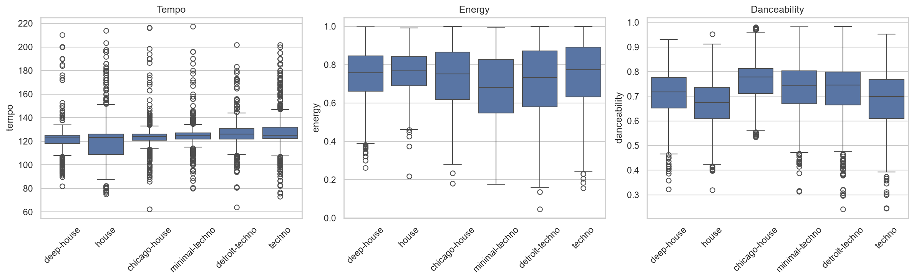
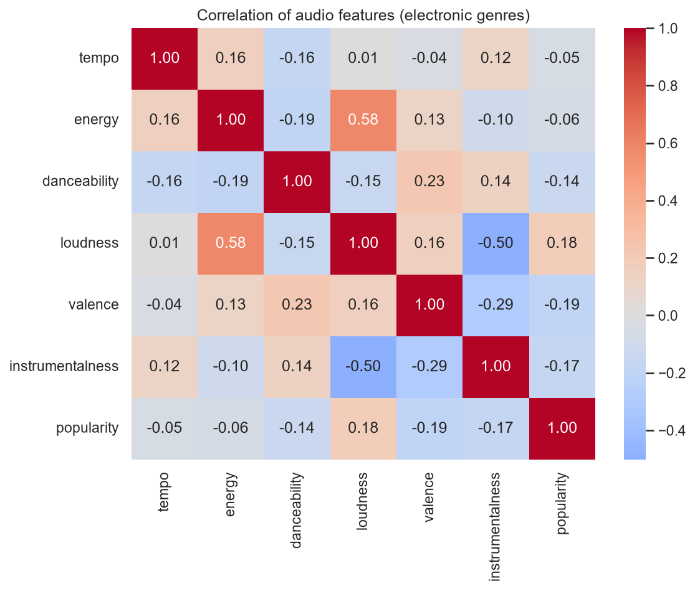

# Techno vs. House: what makes a track danceable?

A data analysis of ~114,000 Spotify tracks comparing electronic music genres
(techno, minimal techno, Detroit techno, house, deep house, Chicago house)
by tempo, energy and danceability.

## Questions
1. How do BPM, energy and danceability differ between techno and house sub-genres?
2. Which audio features go together with danceability?
3. Can a simple regression model explain danceability?

## Data
[Spotify Tracks Dataset](https://www.kaggle.com/datasets/maharshipandya/-spotify-tracks-dataset) (Kaggle).
Download `dataset.csv` and place it in `data/`.

## Methods
pandas (cleaning, groupby), seaborn/matplotlib (boxplots, heatmap, scatter), statsmodels (OLS regression).

## Results


**What I found**
- Techno is the fastest genre (~128 BPM), house and deep house the slowest (~121 BPM)
- Chicago house is the most danceable (0.77), so faster/harder doesn't mean more danceable
- Valence (positive mood) is most linked to danceability (r = 0.23), energy and tempo are slightly negative
- A simple regression only explains about 16% of danceability (R² = 0.16), so groove and rhythm probably matter more



## How to run
```bash
pip install -r requirements.txt
jupyter notebook techno_vs_house.ipynb
```

## About me
I'm a DJ (techno/house) and study Computerlinguistik at LMU München, so I wanted to look at the music I play with data.
